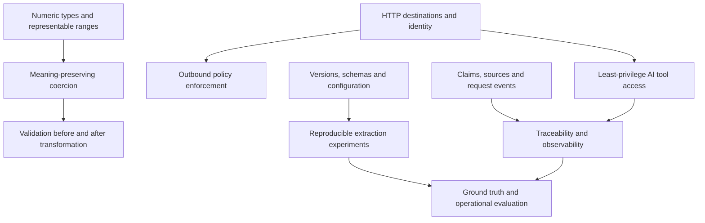

# Learning workshop — 2026-10-12

## Why these concepts matter this week

**DRAFT for discussion with the Data Engineering Learning Coach.** This workshop covers the due `biweekly_opportunity` review. Nothing here is finalized, and no permanent resources have been changed.

The report points to six reusable engineering concepts: preserving meaning during type conversion; enforcing outbound data boundaries; governing AI tool access; reproducing experiments across independently versioned components; evaluating document extraction; and separating source traceability from correctness.

The immediate correctness signal is Pandera’s published integer-overflow fix. The other opportunities suggest controlled pilots—not assumptions about Kienbaum’s installed software, permissions, or Azure configuration.

**Keep the evidence distinctions intact:**

- Pandera `v0.34.0` is a published GitHub release; the earliest affected version and independently verified PyPI artifacts remain incomplete evidence. [Release](https://github.com/unionai-oss/pandera/releases/tag/v0.34.0)
- Foundry hosted-agent egress controls are **preview**, without a preview SLA and not intended for production. [Walkthrough](https://devblogs.microsoft.com/foundry/egress-controls-hosted-agent/)
- Azure DevOps Remote MCP is **GA**, announced in August—not a new October launch. Individual tools can have different maturity levels. [GA announcement](https://learn.microsoft.com/en-us/azure/devops/release-notes/2026/sprint-278-update)
- CU CLI is **preview**, even when it calls the `2025-11-01` **GA service API**. [September release notes](https://learn.microsoft.com/en-us/azure/ai-services/content-understanding/whats-new#september-2026)
- `ellmer 0.5.0` is a published CRAN release; provider-hosted file-management methods remain experimental. [Changelog](https://ellmer.tidyverse.org/news/index.html#ellmer-050)

**70-minute session:** framing and learning map, 6 minutes; six concept exercises, respectively 9, 10, 9, 8, 10, and 10 minutes; retrieval practice and discussion, 8 minutes. Exercises are tabletop activities unless the coach authorizes a sandbox.

All supplied relevant topic and review-card files are blank. Consequently, every selected concept is **NEW CONCEPT** relative to the supplied resource—not necessarily new to the participants. No existing finalized entry is presumed, and no **NO UPDATE NEEDED** classification is justified by these files.

Release-specific statements below come from the supplied report and its linked sources. Explanations, hypothetical Kienbaum-relevant scenarios, and proposed tests are teaching context, not claims about current adoption.

## Learning map

The arrows show useful prerequisites and connections, not a requirement to master every branch first. Participants can use familiar ETL, API, and analytics practices as anchors.

## Concepts

### 1. Meaning-preserving coercion and validation order

**Classification: NEW CONCEPT.** The blank validation resource contains no treatment of transformations that make invalid inputs appear valid.

**Prerequisites:** integer ranges, signed versus unsigned types, and schema validation.

**Report signal:** The upstream reproduction shows `300` becoming `44` when coerced to `int8`, then passing a maximum-value check. The published fix rejects overflowing integer-to-integer coercion; float-to-integer truncation is outside its scope. [Fix and reproductions](https://github.com/unionai-oss/pandera/pull/2443)

**Intuition:** A validator can inspect the wrong value perfectly. If transformation changes meaning first, downstream checks may certify corrupted data.

**Technical explanation:** A signed 8-bit integer represents −128 through 127. A narrowing conversion must establish representability before casting. In a wrapping conversion, discarded bits can map an out-of-range input to an unrelated in-range output. Therefore distinguish:

1. original-input validity;
2. representability in the destination type;
3. validity of the transformed output.

A successful third check does not prove the first two.

**Example:** A hypothetical staffing pipeline accepts headcounts, narrows their storage type, and checks that counts are at most 100. Input `300` must not become an accepted `44`. Wider storage may solve representability, but the business-rule violation still needs handling.

**Exercise—9 minutes:** Design a regression matrix for `300 → int8`, `-1 → uint8`, and `70000 → int16`. Add boundary and valid cases. Decide what happens to rejected records.

**Expected answer:** Reject all three unrepresentable conversions; preserve valid values exactly; test both sides of each type boundary. Record a sanitized failure reason and quarantine or stop according to the pipeline contract. If historical outputs may be affected, investigate them rather than merely loosening the schema. Do not infer that every earlier Pandera version or backend has this behavior.

**Why it matters / misconception:** “Passed validation” is not equivalent to “preserved the input’s meaning.” This connects to lossy date parsing, decimal rounding, and identifier normalization.

**Recommended topic-file destination:** `learning/validation-and-data-quality.md`, proposed category **Transformation correctness and coercion**. It is the closest fit because the central issue is correctness across a transformation.

**Recommended review-card destination:** `review-cards/validation-and-data-quality.md`, matching proposed category. The file exists but has no existing section or card.

### 2. Egress policies as one layer of a data boundary

**Classification: NEW CONCEPT.** No supplied security entry covers destination-based outbound controls.

**Prerequisites:** HTTP requests, destination hosts, and allow/deny policies.

**Report signal:** Foundry’s documented preview distinguishes Audit and Enforced modes. Transform and Rewrite rules still execute in Audit, and required platform connectivity is separately permitted. The documented scope is hosted-agent HTTP/HTTPS traffic—not all protocols or agent types. [Walkthrough](https://devblogs.microsoft.com/foundry/egress-controls-hosted-agent/)

**Intuition:** A gatekeeper can restrict where a parcel goes without deciding whether its contents are appropriate.

**Technical explanation:** Egress policy constrains outbound destinations on an applicable execution path. It is separate from destination authentication, payload authorization, and data minimization. Audit provides observational evidence but must not be treated as entirely side-effect-free. Enforced behavior needs runtime verification; a configuration screenshot is not proof.

**Example:** A hypothetical document assistant may contact an approved extraction endpoint but should not upload documents to a URL embedded in document text. Nevertheless, an approved endpoint must receive only authorized content.

**Exercise—10 minutes:** Design a synthetic-data test with one approved endpoint and one denied endpoint. What evidence proves enforcement?

**Expected answer:** In Audit, inspect calls and would-deny decisions, accounting for transformations. Use a separate Enforced test deployment; require the approved call to succeed and the denied endpoint to receive no request. Correlate unique request identifiers across policy diagnostics and endpoint logs. An arbitrary `403` could originate from authentication or the destination itself and is insufficient proof.

**Why it matters / misconception:** “Default deny” does not establish total network isolation, particularly with platform exceptions. Network policy complements—not replaces—application validation and identity controls.

**Recommended topic-file destination:** `learning/security.md`, proposed category **Outbound controls and defense in depth**. Security is more specific than deployment for the boundary concept.

**Recommended review-card destination:** `review-cards/security.md`, same proposed category; no existing section is presumed.

### 3. AI tool access: discovery is not authorization

**Classification: NEW CONCEPT.** The supplied API and security files contain no relevant entries.

**Prerequisites:** API clients, authentication, authorization, and read/write operations.

**Report signal:** Azure DevOps Remote MCP supports hosted tool access and read-only operation. Tool filtering does not replace OAuth scopes or user permissions; supported organization and client authentication conditions must be checked. [Setup and scope guidance](https://learn.microsoft.com/en-us/azure/devops/mcp-server/remote-mcp-server)

**Intuition:** Showing an assistant fewer buttons is useful, but permissions determine what it can actually do.

**Technical explanation:** MCP standardizes interaction between AI clients and external tools. Keep four layers separate: tools exposed to the client; client/server read-only behavior; identity scopes; and resource permissions. Effective access depends on the complete enforced path, not on tool visibility alone.

Read-only also does not mean harmless: authorized reads can reveal sensitive repository content, and retrieved text can contain hostile instructions. Treat that text as evidence, not as authority to change the task.

**Example:** A hypothetical release-summary assistant reads pull requests, work items, and builds from one low-sensitivity project. It must neither write comments nor obtain material from another project.

**Exercise—9 minutes:** Propose positive and negative tests for a pilot using `repos,wit,pipelines` and `X-MCP-Readonly: true`.

**Expected answer:** Verify allowed reads and source-linked summaries; attempt controlled writes and inaccessible-project reads; confirm denial at the server/resource boundary. Check least-privilege scopes, avoid Insiders, and manually verify evidence. Do not invent the exact error code or assume every client supports the same authentication flow.

**Why it matters / misconception:** A standardized integration interface is not a security certification. This connects to capability design, least privilege, and prompt-injection-resistant workflows.

**Recommended topic-file destination:** `learning/apis-and-networking.md`, proposed category **AI tool protocols and access boundaries**. Teach MCP as an interface, with a future cross-link to security rather than duplicate entries.

**Recommended review-card destination:** `review-cards/apis-and-networking.md`, corresponding proposed category; currently blank.

### 4. Reproducibility across independently versioned layers

**Classification: NEW CONCEPT.** No supplied deployment entry covers experiment manifests or component-specific maturity.

**Prerequisites:** package pinning, API versions, configuration, and schemas.

**Report signal:** Preview CU CLI can call GA or preview service APIs. Analyzer setup can depend on models and defaults; the documented `prebuilt-layout` path does not require a language or embedding model. `ellmer` also changed default models, making explicit model selection important. [CU CLI documentation](https://github.com/Azure/content-understanding-toolkit/tree/main/cu-cli) · [`ellmer` announcement](https://opensource.posit.co/blog/2026-09-14_ellmer-0-5-0/)

**Intuition:** Recording the application version alone is like recording an oven model without the recipe or temperature.

**Technical explanation:** An experiment is determined by a tuple: client version, service API version, analyzer/schema, model selection where applicable, configuration, input corpus, and evaluation code. Pin controllable components and record the rest. Remote services may still change, so reproducibility does not guarantee bit-identical output.

**Exercise—8 minutes:** Draft a run manifest for a synthetic contract-extraction pilot.

**Expected answer:** Record the exact CLI version, explicit `2025-11-01` API selection, analyzer definition and hash, relevant defaults/model deployment, input hashes, evaluation-code revision, timestamp, and sanitized results. Record regional and retention decisions separately. Label the CLI **preview** and the chosen API **GA**; do not label the whole stack GA.

**Why it matters / misconception:** Selecting a GA API does not stabilize preview client commands or experimental features. Reproducibility also differs from portability and production readiness.

**Recommended topic-file destination:** `learning/deployment-and-infrastructure.md`, proposed category **Experiment manifests and layered versioning**. No new topic file is needed.

**Recommended review-card destination:** `review-cards/deployment-and-infrastructure.md`, matching proposed category; currently blank.

### 5. Ground-truth evaluation and operational acceptance

**Classification: NEW CONCEPT.** The supplied statistics resource contains no extraction-evaluation entry.

**Prerequisites:** labeled examples, denominators, sampling, and error categories.

**Report signal:** The proposed CU pilot uses 20–30 synthetic or approved redacted documents with expected values, measuring accuracy, missingness, normalization, review rate, latency, and cost. Confidence alone is not correctness. [CLI documentation](https://github.com/Azure/content-understanding-toolkit/tree/main/cu-cli) · [Practical guidance](https://devblogs.microsoft.com/foundry/choosing-azure-document-intelligence-and-content-understanding/)

**Intuition:** A confident answer is a prediction; a checked answer has been compared with an agreed reference.

**Technical explanation:** Define correctness before inspecting results. Separate field presence, value correctness, normalization, and evidence support. Count missing expected fields in the denominator rather than evaluating only returned values. Report important document subgroups because aggregate performance can conceal systematic failure.

A confidence score is not automatically a calibrated probability. Calibration requires checking whether stated confidence corresponds to observed correctness on relevant data.

**Exercise—10 minutes:** In a hypothetical 25-document pilot, 100 field instances are expected. Ninety are returned; 81 returned values are correct. Compute two metrics and propose an acceptance decision.

**Expected answer:** Returned-value accuracy is 81/90 = **90%**; all-expected-field correctness is 81/100 = **81%**. Neither alone establishes deployment readiness. Inspect missing fields, critical-field errors, review effort, latency, and cost. A small pilot informs feasibility but cannot establish robust production performance. Avoid calling the second metric “recall” unless the task’s positive cases are formally defined.

**Why it matters / misconception:** High aggregate accuracy does not imply acceptable errors in contract dates, currency amounts, or identifiers. Compare against an existing workflow, if one exists—not an assumed baseline.

**Recommended topic-file destination:** `learning/statistics-and-evaluation.md`, proposed category **Structured-extraction evaluation**. Cross-link validation later for field contracts.

**Recommended review-card destination:** `review-cards/statistics-and-evaluation.md`, same proposed category; currently blank.

### 6. Provenance versus correctness; request telemetry versus content logging

**Classification: NEW CONCEPT.** No supplied observability entry distinguishes these evidence layers.

**Prerequisites:** source references, claims, request identifiers, and latency measurements.

**Report signal:** `ellmer 0.5.0` preserves provider citations and adds per-request start/end callbacks. Citation support depends on provider tools; retained citations do not establish correct interpretation. [Changelog](https://ellmer.tidyverse.org/news/index.html#ellmer-050)

**Intuition:** A citation is a trail to inspect, not a seal of truth. A request timer measures service behavior, not answer quality.

**Technical explanation:** Separate three checks: citation preservation, claim-to-source support, and factual/computational correctness. Instrument individual model requests with correlation identifiers so a multi-request workflow can be reconstructed. Useful sanitized telemetry includes provider/model, duration, status, and request count; raw prompts and responses need not be logged.

**Exercise—10 minutes:** A brief cites a source saying revenue increased from 100 to 120, but claims “a 25% increase.” Its three model requests took 2, 4, and 3 seconds. Identify what is and is not established.

**Expected answer:** The reference may be preserved, but the claim is wrong: deterministic calculation gives **20%**. Request durations do not necessarily equal end-to-end latency because calls may overlap and tools add time. Capture parent-run duration separately, verify claim support, and calculate statistics in deterministic R or Python.

**Why it matters / misconception:** “Has citations” and “has traces” are not equivalent to “is correct.” Provenance supports auditability; telemetry supports diagnosis; evaluation tests quality.

**Recommended topic-file destination:** `learning/observability-and-reliability.md`, proposed category **AI workflow evidence and request telemetry**. Add a future cross-link to AI systems without duplicating the concept.

**Recommended review-card destination:** `review-cards/observability-and-reliability.md`, matching proposed category; currently blank.

## Proposed permanent-resource changes

**Proposals only, subject to human review and explicit coach finalization:**

- **`learning/README.md`:** No taxonomy change or new file is needed. Existing descriptions already route all six concepts appropriately. Concept-level links could be added only if the coach chooses that convention.
- **Topic files:** Add the six scoped entries under the proposed categories above, incorporating prerequisites, technical distinctions, worked examples, and source links. Preserve the limits on backend coverage, network scope, maturity, and small-sample evidence.
- **Review-card files:** Add the six proposed cards below after review, using the corresponding existing filenames.
- **Cross-links:** Optionally connect API access to security, extraction evaluation to validation, and AI telemetry to AI systems. Do not presume any target sections already exist.
- **Finalization:** No entry is finalized by this workshop. Only the interactive Learning Coach can finalize content after human review. The Coordinator’s separate draft-saving action is not permanent-resource adoption.

## Proposed review cards

### 1. Meaning-preserving coercion

- **Recall:** Check representability before casting; output validity cannot prove input meaning was preserved.
- **Mental hook:** A validator can approve the wrong value.
- **Why I care:** Silent narrowing can corrupt apparently validated reporting inputs.
- **Contrast:** Type-valid versus meaning-preserving.
- **Tiny example:** `300 → int8` must fail, not become `44`.
- **Test yourself:** Why does checking `value <= 100` after wrapping miss the original problem?
- **First learned date:** 2026-10-12 — proposed, not finalized.
- **Recommended review-card destination:** `review-cards/validation-and-data-quality.md`.

### 2. Egress boundary

- **Recall:** Destination controls restrict where applicable requests go, not whether payloads are appropriate.
- **Mental hook:** Approved address, possibly inappropriate parcel.
- **Why I care:** Agents can encounter unexpected upload destinations.
- **Contrast:** Audit evidence versus enforced prevention.
- **Tiny example:** Approved endpoint succeeds; denied endpoint receives nothing.
- **Test yourself:** Why is one `403` insufficient enforcement evidence?
- **First learned date:** 2026-10-12 — proposed.
- **Recommended review-card destination:** `review-cards/security.md`.

### 3. Tool-access governance

- **Recall:** Tool exposure, read-only controls, scopes, and resource permissions are distinct layers.
- **Mental hook:** Hidden buttons are not locked doors.
- **Why I care:** Read-only assistants can still expose sensitive information.
- **Contrast:** Discovery versus authorization.
- **Tiny example:** Allow project A reads; deny writes and project B reads.
- **Test yourself:** Which negative tests establish the intended access boundary?
- **First learned date:** 2026-10-12 — proposed.
- **Recommended review-card destination:** `review-cards/apis-and-networking.md`.

### 4. Layered reproducibility

- **Recall:** Record client, API, schema/analyzer, model, configuration, inputs, and evaluation code.
- **Mental hook:** Save the recipe, not just the oven.
- **Why I care:** Unrecorded changes confound pilot comparisons.
- **Contrast:** GA API versus preview CLI.
- **Tiny example:** Pin CLI; explicitly select `2025-11-01`; hash schema and inputs.
- **Test yourself:** What can still vary after package pinning?
- **First learned date:** 2026-10-12 — proposed.
- **Recommended review-card destination:** `review-cards/deployment-and-infrastructure.md`.

### 5. Extraction evaluation

- **Recall:** Define correctness and denominators; include missing fields and inspect critical subgroups.
- **Mental hook:** Confidence predicts; ground truth checks.
- **Why I care:** Attractive aggregate metrics can hide operationally costly errors.
- **Contrast:** Returned-value accuracy versus all-expected-field correctness.
- **Tiny example:** 81/90 = 90%; 81/100 = 81%.
- **Test yourself:** What evidence is missing before automating critical contract fields?
- **First learned date:** 2026-10-12 — proposed.
- **Recommended review-card destination:** `review-cards/statistics-and-evaluation.md`.

### 6. Evidence and telemetry

- **Recall:** Verify citation survival, claim support, and correctness separately; measure requests and total runs.
- **Mental hook:** A trail is not a truth guarantee.
- **Why I care:** Source-linked errors and hidden tool loops remain possible.
- **Contrast:** Provenance versus validation; latency versus quality.
- **Tiny example:** Source says 100→120; deterministic calculation gives 20%, not 25%.
- **Test yourself:** Which diagnostic measurements can you retain without prompt content?
- **First learned date:** 2026-10-12 — proposed.
- **Recommended review-card destination:** `review-cards/observability-and-reliability.md`.

## Questions worth discussing

1. Which transformations in our work could change meaning before validation, and how would we investigate historical outputs?
2. What evidence would distinguish enforced egress denial from an unrelated request failure?
3. What residual risks remain when an AI repository assistant has genuinely read-only access?
4. Which experiment components can we pin, and which can only be recorded or monitored?
5. Which extraction errors require mandatory human review even when aggregate accuracy looks strong?
6. How should we verify source-linked AI claims while retaining useful diagnostics without sensitive content?