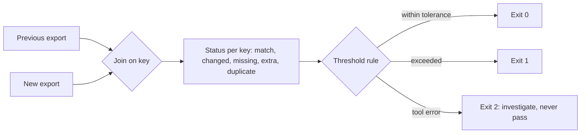
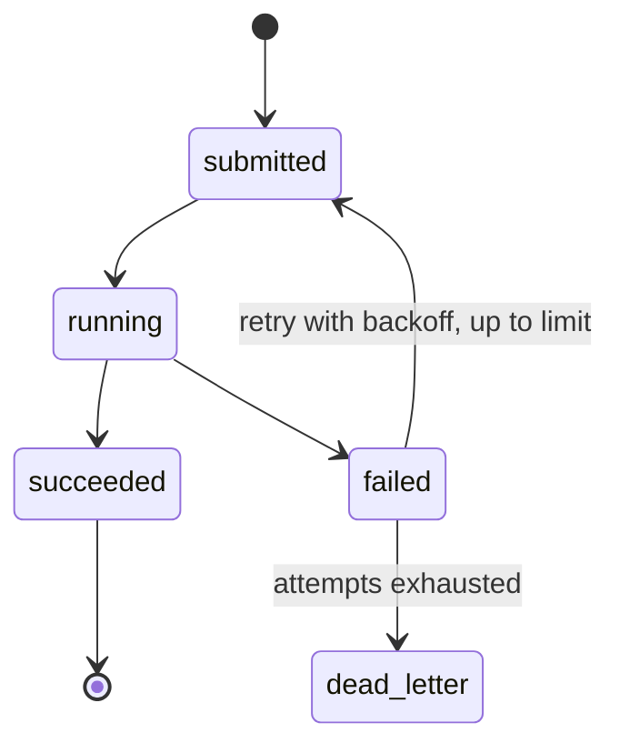
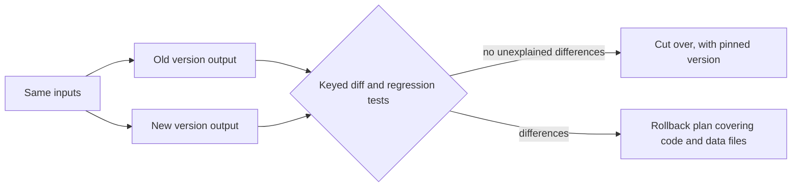
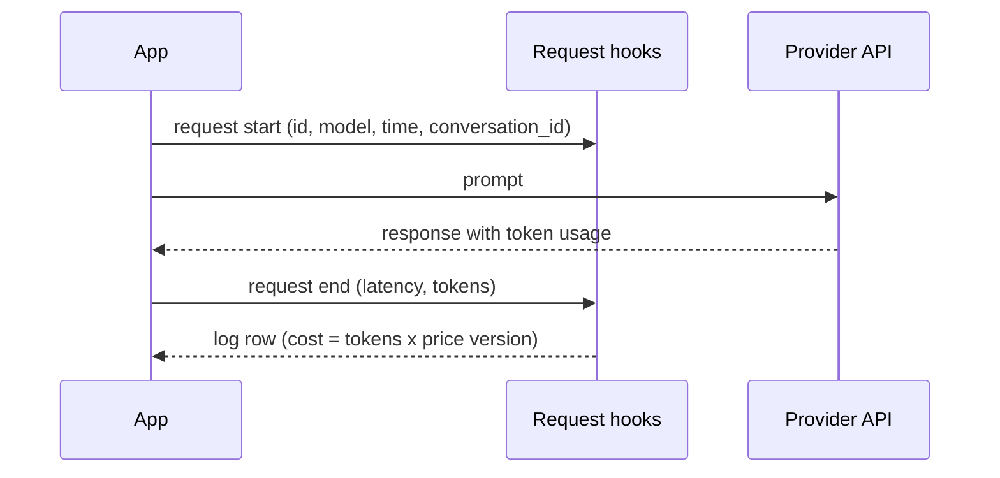

# Learning workshop — 2026-10-26

**Status: DRAFT for Learning Coach discussion.** This is text for the parent agent. I have not written it to disk. It is intended for `drafts/2026-10-26-learning-workshop.md`. No permanent topic, index, or review-card file was changed.

## Why these concepts matter this week

This week's opportunity items (Pointblank v1.1.0, Azure AI Content Understanding, DuckDB 2.0.0 LTS, ellmer 0.5.0, and Azure DevOps Copilot code review) share one theme: each asks the team to prove that a change is safe before relying on it. The proof takes four forms: a keyed reconciliation, a labelled evaluation set, a shadow run against the old version, and a data-handling decision made before data leaves the boundary. The workshop covers six concepts that support those checks.

| # | Concept | Driven by (report item) | Topic file (recommended) |
|---|---|---|---|
| 1 | Keyed reconciliation with tolerances and CI gating | Pointblank (1) | validation-and-data-quality.md |
| 2 | Asynchronous batch jobs and service limits | Azure AI Content Understanding (2) | data-processing.md |
| 3 | Ground-truth evaluation of AI extraction | Azure AI Content Understanding (2) | ai-and-llm-systems.md |
| 4 | Controlled upgrades: pinning, support lifecycles, shadow migration | DuckDB (3), ellmer (4), Pointblank (1) | deployment-and-infrastructure.md |
| 5 | Instrumenting LLM calls: hooks, tokens, cost | ellmer (4), Copilot billing (5) | ai-and-llm-systems.md |
| 6 | Data-handling boundaries for third-party AI services | Pointblank, Content Understanding, ellmer, Copilot (1, 2, 4, 5) | security.md |

**Scope**

- The workshop covers opportunity items 1 to 5, as the run note requests.
- Item 6 (Azure AI Content Safety, immediate check) and the DuckDB 1.5.6 patch check are operational actions. They are not taught here. The DuckDB 1.4 end-of-support date (17 Nov 2026) appears only as context for Concept 4.

**Existing knowledge status**

- All supplied relevant topic and review-card files are empty. Every concept is therefore classified **NEW CONCEPT**, marked "new - no existing topic content." No prior learning dates are inherited, and no prior entries were assumed.
- Not supplied: statistics-and-evaluation.md and observability-and-reliability.md, which are indexed and adjacent to Concepts 3 and 5. The duplication check for those two areas is incomplete.

**Source tags used below**

- **[Report]**: stated in the release-intelligence report.
- **[General]**: standard teaching context, not from the report.
- **[Inference]**: my reasoning from the report, to be verified in the pilot.

**Evidence limits**

- No installed versions were provided, so Kienbaum's exposure to each item is unknown.
- Nothing was independently verified in this run.
- The Azure DevOps Copilot status conflicts between sources and is unresolved.
- CRAN was unavailable, so R coverage relies on GitHub release pages.

## Learning map

```text
Primary keys and row identity
↓
Keyed reconciliation with tolerances            [Concept 1]
↓
Gated CI checks (exit codes)                    [Concept 1]

Synchronous request/response
↓
Asynchronous jobs, polling, limits              [Concept 2]
↓
Ground-truth evaluation of extracted fields     [Concept 3]

Model and API behaviour changes over time
↓
Pinning, GA vs preview, LTS                     [Concept 4]
↓
Shadow migration with compatibility checks      [Concept 4]

Third-party services receive data
↓
Data-handling boundary review                   [Concept 6]
↓
Instrument calls: hooks, tokens, cost           [Concept 5]
```

## Concepts

### Concept 1 — Keyed reconciliation with tolerances and CI gating

**Classification:** NEW CONCEPT (new - no existing topic content)

**Reason:** Reconciliation is a reusable way to compare two datasets. It is not covered anywhere in the supplied material.

**Prerequisites**

- Natural or primary keys and uniqueness. Row order is not identity.
- Set difference, or anti-join, in SQL: rows in A that are not in B.
- Exit codes and how CI jobs fail on a non-zero code.
- The difference between an absolute count threshold and a proportional threshold.

**Intuition**

A file hash tells you that something changed. A row count can match while the contents differ. Keyed reconciliation aligns rows by identity and labels each one, so you know which rows changed and whether the change matters.

**Technical explanation**

- Given an old table A and a new table B with key K, each key falls into one of five states:
  - **match**: same key, same values;
  - **changed**: same key, different non-key values;
  - **missing**: in A only;
  - **extra**: in B only;
  - **duplicate**: the key appears more than once.
- A threshold rule then decides pass or fail, using either an absolute count or a share of rows.
- **[Report]** Pointblank's `pb.compare()` and `tbl_reconcile()` classify rows this way. Its `tbl_match()` treats fractional thresholds as a share of failing rows, and `thresholds=1` restores fail-on-any-difference.
- **[Inference]** This suggests that an integer threshold (1, a count) and a float threshold (1.0, a proportion) mean different things. Confirm this in the pilot before relying on it.
- **[Report]** The `pb compare` CLI returns 0 for match, 1 for differences, and 2 for error, so CI can gate on it.
- **[General]** Exit code 2 (error) must not be treated as "no differences." A pipeline that maps error to pass is a silent failure.

**Realistic data-engineering example**

A monthly revenue export is refactored from one SQL view into dbt models. The team reconciles old and new output on the key (order_id, line_no), expecting zero missing and zero extra rows, and allowing a 0.01 currency tolerance for rounding. Here is what the comparison computes, written as plain SQL for illustration (not Pointblank syntax; null handling is omitted and a real check must handle NULLs explicitly):

```sql
SELECT coalesce(a.order_id, b.order_id) AS order_id,
       CASE WHEN a.order_id IS NULL THEN 'extra'
            WHEN b.order_id IS NULL THEN 'missing'
            WHEN abs(a.amount - b.amount) > 0.01 THEN 'changed'
            ELSE 'match' END AS status
FROM old_export AS a
FULL OUTER JOIN new_export AS b USING (order_id);
-- Duplicates need a separate count per key: GROUP BY key HAVING count(*) > 1
```

**Why it matters**

Silent data drift is a common correctness failure. A check that cannot tell "changed" from "missing" either produces noisy failures or misses real data loss.

**Common misconception**

"Matching row counts means the data matches." Counts can be equal while keys differ, or values change. Also, a tolerance is not a free safety margin. Set too loose, it hides real changes. Set too tight, it fails on harmless rounding.

**Relationship to adjacent concepts**

- Data-quality rules check one table against its own constraints. Reconciliation compares two tables.
- Reconciliation is regression testing for data outputs.
- Gating (exit codes) contrasts with advisory AI review in Concept 6.

**Pilot angle [Report]**

Compare two versions of one report export. Test three known differences to confirm exit codes and tolerances. The v1.0.1 fix for wrong row numbers on Polars LazyFrame extracts is a reason to check that reported row identities point to the right rows.



**Recommended topic-file destination**

- **learning/validation-and-data-quality.md**, proposed new section "Reconciliation across datasets."
- Rationale: this is the closest existing category. It is about validating data outputs, so no new file is warranted. The file is empty, so this is a proposal for coach review.

**Recommended review-card destination**

- **review-cards/validation-and-data-quality.md**, closest available destination.
- Uncertainty: the supplied card file is empty and has no section structure, so no section can be confirmed.

### Concept 2 — Asynchronous batch jobs and service limits

**Classification:** NEW CONCEPT (new - no existing topic content)

**Reason:** Long-running processing with size limits is a broad data-processing pattern. It recurs across document, export, and batch APIs.

**Prerequisites**

- Synchronous request and response, timeouts, and HTTP status codes.
- Job lifecycle: submit, run, terminal state, retrieve result.
- Polling, with backoff.
- Idempotency: resubmitting a job must not duplicate outputs.
- Quotas and per-unit billing.

**Intuition**

A synchronous call is a phone call: you wait on the line. An asynchronous job is a ticket: you submit it, keep the receipt, and come back for the result. Service limits decide which mode a given input must use.

**Technical explanation**

- **[Report]** The synchronous limit for Azure AI Content Understanding is 5 pages. The asynchronous PDF/TIFF limit was raised from 300 to 2,000 pages in October 2026. A 2,000-page document therefore cannot go through the synchronous path.
- **[General]** Long-running operations usually return an operation identifier. The client polls for status until a terminal state, then retrieves the result. Polling needs backoff, and a failed job needs a defined route such as a dead-letter table.
- **[Inference]** A pipeline must branch on size. Hardcoding a limit in code creates a silent failure when the limit changes, so the limit should come from configuration.
- **[Report]** Costs are per page, plus contextualization and Foundry model tokens, so a job's cost is driven by its size.

**Realistic data-engineering example**

A nightly job ingests supplier PDF reports of up to 600 pages. Documents of 5 pages or fewer go through the synchronous path. Larger documents are submitted asynchronously, and their state is tracked in a job table:

```sql
CREATE TABLE extraction_jobs (
  doc_id      VARCHAR PRIMARY KEY,
  page_count  INTEGER NOT NULL,
  mode        VARCHAR CHECK (mode IN ('sync', 'async')),
  op_id       VARCHAR,                  -- service operation identifier
  status      VARCHAR NOT NULL,         -- submitted | running | succeeded | failed
  attempts    INTEGER DEFAULT 0,
  updated_at  TIMESTAMP
);
-- Routing: mode = CASE WHEN page_count <= :sync_limit THEN 'sync' ELSE 'async' END
-- :sync_limit is read from configuration, not hardcoded.
```

**Why it matters**

Document pipelines fail quietly when long documents are sent down the synchronous path. An explicit job table makes state visible and makes the pipeline restartable.

**Common misconception**

- "Async means faster." Asynchronous processing changes how you wait. It is chosen for size and duration, not speed. Total latency depends on queueing and service limits.
- "Polling is a bug." Polling is standard for long-running operations. The real defect is polling without backoff.

**Relationship to adjacent concepts**

- Concurrency (fan-out of many jobs) and idempotency (safe retries) both sit underneath this pattern.
- Dead-letter routing is the failure path.
- Per-unit cost links to Concept 5.

**Recommended topic-file destination**

- **learning/data-processing.md**, proposed new section "Long-running and asynchronous batch jobs."
- Rationale: this is the most specific existing fit for the job-orchestration pattern. The API-specific mechanics (endpoints, polling details) would belong in apis-and-networking.md. That file was not supplied, so its content cannot be compared.

**Recommended review-card destination**

- **review-cards/data-processing.md**, closest available destination.
- Uncertainty: the supplied card file is empty, so no section can be confirmed.



### Concept 3 — Ground-truth evaluation of AI extraction

**Classification:** NEW CONCEPT (new - no existing topic content)

**Reason:** Measuring extraction accuracy against labelled data, and checking whether confidence scores mean anything, is reusable across any AI extraction system.

**Prerequisites**

- Accuracy, precision, and recall, and how they are computed from labelled outcomes.
- Sampling error and confidence intervals. A small sample gives a wide interval.
- Calibration: whether a stated confidence level matches the observed accuracy.
- Manual labelling and its error rate.

**Intuition**

A model's confidence is the model's own opinion. Accuracy is measured against labels that someone trusted. The pilot measures the second.

**Technical explanation**

- **[Report]** Azure AI Content Understanding extracts structured fields with confidence scores and source grounding. The pilot is 30 to 50 non-confidential or synthetic documents, measuring field accuracy against manual labels, cost per document, and latency. It is then repeated on the preview API for an agentic comparison. The preview has no SLA.
- **[General]** Define the evaluation unit first: field-level or document-level. Define a match rule, because "1.000,00 EUR" and "1000.00" may or may not be the same value. Report accuracy per field, not only overall.
- **[General]** For calibration, group predictions into confidence bands and compare each band's observed accuracy with the band's stated confidence. Source grounding is checked by confirming that the cited source span contains the extracted value.
- **[General, computed]** With 45 correct out of 50 fields, accuracy is 90%. The 95% Wilson interval is roughly 79% to 96%. The interval is wide, which is why 30 to 50 documents support a directional decision, not a precise accuracy claim.

Illustrative Python for the interval:

```python
from statsmodels.stats.proportion import proportion_confint
low, high = proportion_confint(count=45, nobs=50, alpha=0.05, method="wilson")
print(f"accuracy 90%, 95% Wilson CI: {low:.2f} to {high:.2f}")
```

**Realistic data-engineering example**

Fifty synthetic invoices are extracted. The total_amount field is correct in 45 cases. Of the 5 failures, 4 carried confidence 0.95 or higher. This shows the confidence scores are not calibrated for that field, and the pipeline should not auto-accept high-confidence totals without a check.

**Why it matters**

Extraction that feeds reports or retrieval-augmented generation (RAG) can be wrong in plausible-looking ways. Unvalidated confidence scores are not evidence.

**Common misconception**

- "High confidence means correct." Confidence is reported by the system and must be measured for calibration.
- "One good demo is an accuracy result." A demo is not a measurement.

**Relationship to adjacent concepts**

- Reconciliation (Concept 1) is the right tool when comparing against a known-good dataset.
- Statistics-and-evaluation (not supplied) covers intervals and calibration in general terms. Only the AI-specific parts belong here.

**Recommended topic-file destination**

- **learning/ai-and-llm-systems.md**, proposed new section "Evaluating extraction against labels."
- Rationale: the concept is specific to AI extraction, so this is the most specific fit. The general statistics belong in statistics-and-evaluation.md, which was not supplied. Cross-reference it once its content is checked.

**Recommended review-card destination**

- **review-cards/ai-and-llm-systems.md**, closest available destination.
- Uncertainty: the card file is empty and has no section structure.

### Concept 4 — Controlled upgrades: pinning, support lifecycles, and shadow migration

**Classification:** NEW CONCEPT (new - no existing topic content)

**Reason:** Upgrade risk recurs across libraries, engines, and cloud APIs. The report contains several instances.

**Prerequisites**

- Semantic versioning (major, minor, patch). Pre-1.0 versions are explicitly unstable.
- Lockfiles and reproducible environments. For R, renv is one example. For Python, a lockfile or pinned constraints serve the same purpose.
- Deprecation versus removal ("defunct").
- Data-format compatibility: whether files written by a new version can be read by an old one.
- Light SQL knowledge for the DuckDB example: parser and timezone behaviour.

**Intuition**

An upgrade changes the code path that produces your numbers. Pinning freezes that path. A lifecycle tells you how long the frozen path stays supported. Shadow testing runs the old and new paths on the same inputs so you can compare before cutover.

**Technical explanation**

- **[Report]** Pointblank: "pin 1.1.1 or later." ellmer 0.5.0 is pre-1.0, so its API may change, and the report says to pin model names.
- **[Report]** DuckDB 2.0.0 LTS has support until at least October 2027. Its breaking changes include:
  - files written by 2.0 cannot be opened by older versions;
  - single-arrow lambda syntax (x -> x + 1) is disabled by default;
  - the new PEG parser is the default, with a legacy_parser fallback;
  - ICU is removed, so timezone and collation behaviour comes from DuckDB's own implementation;
  - C++17 is required.
- **[Report]** DuckDB 1.4 support ends 17 Nov 2026, and the report recommends a shadow test only.
- **[Report]** Azure: the 2025-11-01 API is GA and recommended for production. The 2026-06-01-preview API is for evaluation, with no SLA.
- **[General]** An LTS label means extended support. It does not mean that breaking changes are absent.
- **[General]** Rollback must cover data artifacts as well as code. If a 2.0 writer creates files that 1.x readers cannot open, rolling back the code alone does not restore a working state.
- **[General]** Shadow testing means running the old and new versions on identical inputs, then diffing outputs. Include timestamps and sort order in the diff, because timezone and collation changes show up there.

**Realistic data-engineering example**

A team shadow-tests DuckDB 2.0 against a copy of a production-like database file and a Parquet workload. Timestamp columns are diffed for timezone changes. A code search flags single-arrow lambdas. Because the same token can appear in other SQL contexts, each hit needs manual review, not automatic replacement. The regression diff uses set difference and is keyed, so duplicates are not hidden:

```sql
-- Set-level diff (note: EXCEPT removes duplicate rows; use a keyed count for multiset checks)
SELECT * FROM v14_output EXCEPT SELECT * FROM v20_output;
SELECT * FROM v20_output EXCEPT SELECT * FROM v14_output;
```

```bash
# Find candidate single-arrow lambda uses for manual review
grep -rn -- '->' sql/ | head -n 50
```

**Why it matters**

Most silent data breaks come from engine or library upgrades that change semantics without changing the call you make. Pinning plus shadow testing makes those changes visible before they reach production numbers.

**Common misconception**

- "LTS means nothing changes." LTS means a longer support window. The report lists breaking changes in DuckDB 2.0.0 LTS.
- "Pinning means never upgrading." Pinning means upgrading deliberately. Without pinning, upgrades happen by accident.
- "Preview is an early GA." A preview has no SLA and may change.

**Relationship to adjacent concepts**

- Reconciliation (Concept 1) is the comparison method for shadow outputs.
- Lifecycle thinking applies to cloud API versions, to model identifiers (Concept 5), and to data formats.



**Recommended topic-file destination**

- **learning/deployment-and-infrastructure.md**, proposed new section "Versioning, support lifecycles and migration."
- Rationale: deployment and version management are the closest category. The shadow-test technique is a data-processing practice, so cross-reference data-processing.md.

**Recommended review-card destination**

- **review-cards/deployment-and-infrastructure.md**, closest available destination.
- Uncertainty: the card file is empty and has no section structure.

### Concept 5 — Instrumenting LLM calls: hooks, tokens, and cost

**Classification:** NEW CONCEPT (new - no existing topic content)

**Reason:** Measuring latency, tokens, cost, and call lineage is reusable across any LLM workflow.

**Prerequisites**

- Logs, metrics, traces, and spans.
- Input and output tokens. Token counts depend on the tokenizer, so they differ across models.
- Pricing as a function of model and tokens. Price tables change over time.
- Versioned model identifiers.
- Structured logging.

**Intuition**

An LLM call is a remote function with variable cost and latency. A hook is a measuring instrument placed around each call. It records what happened, so you do not depend on memory or on the final answer to know what the workflow did.

**Technical explanation**

- **[Report]** ellmer 0.5.0 adds `$on_request_start()` and `$on_request_end()` hooks, `$token_count()`, `models_update_prices()`, and a `conversation_id` for tracing spans. The pilot is to log latency and tokens for 100 prompts via the hooks.
- **[Report]** Copilot code review is billed in GitHub AI credits (1 credit = $0.01) through Azure Cost Management, with charges appearing after 48 hours. Budget alerts are set at 75% and 90%.
- **[Report]** ellmer's release notes say several provider default models changed (for example, chat_openai() now uses gpt-5.6-terra). Without per-call records, that kind of change is hard to attribute.
- **[General]** Cost per call is tokens multiplied by the price for that model. Store the price-table version with each record, because a locally cached price can drift from the invoice. Reconcile the two periodically.
- **[Inference]** Billing lag, as with the 48-hour Copilot delay, means that budget alerts and local cost estimates both need a reconciliation step.

**Realistic data-engineering example**

An R workflow classifies 100 free-text complaint records with ellmer. Each request writes one row to a call-log table: request_id, model string, start and end times, latency_ms, input_tokens, output_tokens, estimated cost, and conversation_id. The following query summarises the log (the table is a hypothetical design):

```sql
SELECT model,
       count(*)                                AS calls,
       quantile_cont(latency_ms, 0.95)         AS p95_latency_ms,
       sum(est_cost_usd)                       AS est_cost_usd
FROM llm_call_log
GROUP BY model
ORDER BY est_cost_usd DESC;
```

**Why it matters**

LLM workflows drift in cost and behaviour. Per-call records make cost attributable, and they help detect silent default changes.

**Common misconception**

- "Token counts are the same across models." Tokenizers differ.
- "Logging prompts is harmless." Prompts and responses can contain personal data. Log metadata by default, and log content only under a data policy (see Concept 6).

**Relationship to adjacent concepts**

- Observability: spans and metrics come from general observability practice.
- Pinning (Concept 4): model identifiers are versioned strings that must be pinned.
- Data handling (Concept 6): what gets logged is a data-handling decision.



**Recommended topic-file destination**

- **learning/ai-and-llm-systems.md**, proposed new section "Instrumenting LLM calls."
- Rationale: the routing rule favours the most specific fit, and this concept is about LLM call semantics (tokens, prices, model identifiers). The general spans-and-metrics material belongs in observability-and-reliability.md, which was not supplied. Cross-reference it after checking.

**Recommended review-card destination**

- **review-cards/ai-and-llm-systems.md**, closest available destination.
- Uncertainty: the card file is empty and has no section structure.

### Concept 6 — Data-handling boundaries for third-party AI services

**Classification:** NEW CONCEPT (new - no existing topic content)

**Reason:** Sending data to an external service is a data transfer, and this decision recurs for every AI tool.

**Prerequisites**

- Data classification: public, internal, confidential, personal.
- What a vendor may do with data: retention, region, use for training, subprocessors.
- Least privilege and secret handling for API keys and connection strings.
- Advisory versus enforced controls.
- Logging content versus logging metadata.

**Intuition**

A library that calls an LLM is a data transfer, not just a function call. Before adding it to a pipeline, decide which classes of data may cross that boundary.

**Technical explanation**

- **[Report]** Pointblank's `prompt()` sends data to an LLM, so the data policy must be checked.
- **[Report]** The Content Understanding pilot uses only non-confidential or synthetic documents.
- **[Report]** The Copilot code review data-handling FAQ was not reviewed, so it must be checked before the pilot. The report does not describe what the tool transmits, so do not assume.
- **[Report]** Copilot code review never approves or blocks merges. Branch policies can trigger it. Pointblank's exit codes do gate CI.
- **[General]** Advisory tools suggest and do not decide. Gating tools change pass or fail, so an outage or a wrong result can block delivery. Both kinds send data, so both need a data-handling decision.
- **[General]** Vendor data policies and default models change over time, so the decision needs periodic review.

**Realistic data-engineering example**

An ellmer script is proposed to classify free-text survey responses, which may contain personal data. Before any call, the team checks the data class. Only synthetic or anonymised examples go to the provider, and the decision and its approver are recorded. A simple gate in the pipeline can refuse to run unless the input is labelled with an allowed class:

```python
ALLOWED_CLASSES = {"public", "synthetic"}

def assert_allowed(dataset_class: str) -> None:
    if dataset_class not in ALLOWED_CLASSES:
        raise PermissionError(f"Data class '{dataset_class}' not approved for external AI services")
```

**Why it matters**

The cheapest data incident is the one prevented by a one-page data-handling decision made before the pilot.

**Common misconception**

- "Synthetic data needs no review." Synthetic data can still mirror sensitive structure or rare values.
- "An internal tool is safe." Internal tools may still send data to external services.
- "A vendor preview means no data terms apply." Check the terms. Do not assume.

**Relationship to adjacent concepts**

- Security: secrets, access control, and least privilege.
- Observability (Concept 5): logs are data too.
- Validation (Concept 1): comparison outputs may contain the same sensitive values as the inputs.

**Pre-pilot questions (general checklist)**

| Question | Pointblank prompt() | Content Understanding | ellmer | Copilot code review |
|---|---|---|---|---|
| What data leaves the boundary? | To check | To check | To check | To check (FAQ not reviewed) |
| Where is it processed and retained? | To check | To check | To check | To check |
| Is it used for training? | To check | To check | To check | To check |
| Which data classes are approved? | Record decision | Record decision | Record decision | Record decision |

**Recommended topic-file destination**

- **learning/security.md**, proposed new section "Third-party data handling for AI services."
- Rationale: security is the closest category, and the index has no separate governance file.

**Recommended review-card destination**

- **review-cards/security.md**, closest available destination.
- Uncertainty: the card file is empty and has no section structure.

## Proposed permanent-resource changes

*Proposed for coach review. None of these is applied. Topic files and cards are empty, so no finalized content conflicts with the proposals.*

**Learning-resource index (learning/README.md)**

- No new topic file is proposed. Every concept routes to an existing file under the routing rule.
- Optional, for coach review: add cross-references between ai-and-llm-systems.md and statistics-and-evaluation.md (Concept 3), and between ai-and-llm-systems.md and observability-and-reliability.md (Concept 5), once those supplied files are checked.

**Recommended topic files (each as an additive new section)**

- **validation-and-data-quality.md:** "Reconciliation across datasets" (Concept 1).
- **data-processing.md:** "Long-running and asynchronous batch jobs" (Concept 2).
- **ai-and-llm-systems.md:** "Evaluating extraction against labels" (Concept 3) and "Instrumenting LLM calls" (Concept 5).
- **deployment-and-infrastructure.md:** "Versioning, support lifecycles and migration" (Concept 4).
- **security.md:** "Third-party data handling for AI services" (Concept 6).

**Recommended review-card files**

- Add one card per concept to the matching review-card file: validation-and-data-quality.md, data-processing.md, ai-and-llm-systems.md (two cards), deployment-and-infrastructure.md, and security.md.
- Because the card files are empty and have no section structure, the coach should decide the section layout before any card is added.

**Items not proposed**

- No statistics-and-evaluation.md or observability-and-reliability.md changes are proposed, because their contents were not supplied.

## Proposed review cards

*Proposed for coach review. Each card uses the supplied current date as its First learned date.*

### Card 1 — Keyed reconciliation

- **Recall:** Keyed reconciliation labels every key as match, changed, missing, extra, or duplicate, then applies a threshold rule.
- **Mental hook:** A checksum says that something moved. A reconciliation says which rows moved and whether it matters.
- **Why I care:** Regression checks on data outputs fail silently when they compare counts or hashes instead of keys.
- **Contrast:** Data-quality rules check one table against its own constraints. Reconciliation compares two tables.
- **Tiny example:** Key (order_id, line_no); 2 rows changed by 0.004 (within 0.01 tolerance), 0 missing, 0 extra; exit 0.
- **Test yourself:** Why should a tool error (exit 2) never be treated as a pass?
- **First learned date:** 2026-10-26
- **Recommended review-card destination:** review-cards/validation-and-data-quality.md (closest available; no section structure confirmed).

### Card 2 — Asynchronous batch jobs

- **Recall:** Long-running jobs use submit, poll with backoff, retrieve, and retry idempotently. Routing is driven by size limits.
- **Mental hook:** Synchronous is a phone call. Asynchronous is a ticket with a receipt.
- **Why I care:** Long documents sent down the synchronous path fail, and a job table makes state recoverable.
- **Contrast:** Async is chosen for size and duration, not speed.
- **Tiny example:** A 600-page document is routed to async because the sync limit is 5 pages (limit read from config).
- **Test yourself:** Why should a size limit come from configuration rather than from code?
- **First learned date:** 2026-10-26
- **Recommended review-card destination:** review-cards/data-processing.md (closest available).

### Card 3 — Ground-truth evaluation of extraction

- **Recall:** Evaluate extraction accuracy per field against labels, and check whether confidence scores are calibrated.
- **Mental hook:** Confidence is the model's opinion. Accuracy is measured against trusted labels.
- **Why I care:** Plausible wrong values pass into reports and retrieval systems unless measured.
- **Contrast:** A demo shows that something works. An evaluation measures how often it works.
- **Tiny example:** 45 of 50 correct gives 90%, with a 95% Wilson interval of about 79% to 96%.
- **Test yourself:** Why is a 30-document pilot a directional result, not a precise accuracy claim?
- **First learned date:** 2026-10-26
- **Recommended review-card destination:** review-cards/ai-and-llm-systems.md (closest available).

### Card 4 — Controlled upgrades

- **Recall:** Pin versions, read the support lifecycle, and shadow-test old against new before cutover, including the data files each version writes.
- **Mental hook:** Pinning freezes the path. Shadow testing compares two paths on the same input.
- **Why I care:** Engine upgrades can change results without changing the call.
- **Contrast:** LTS means a longer support window, not no breaking changes.
- **Tiny example:** A set-level EXCEPT diff between v1.4 and v2.0 output on a copied database.
- **Test yourself:** What must a rollback plan cover if a new version writes files that old readers cannot open?
- **First learned date:** 2026-10-26
- **Recommended review-card destination:** review-cards/deployment-and-infrastructure.md (closest available).

### Card 5 — Instrumenting LLM calls

- **Recall:** Record start and end events per call, with latency, tokens, model string, and conversation ID. Compute cost from tokens and a versioned price table.
- **Mental hook:** A hook is a meter around a remote function.
- **Why I care:** Without per-call records, cost cannot be attributed, and silent default-model changes go unnoticed.
- **Contrast:** Token counts differ across tokenizers, so counts are not comparable across models.
- **Tiny example:** A p95 latency and summed estimated cost grouped by model from a call-log table.
- **Test yourself:** Why should the price-table version be stored with each record?
- **First learned date:** 2026-10-26
- **Recommended review-card destination:** review-cards/ai-and-llm-systems.md (closest available).

### Card 6 — Data-handling boundaries

- **Recall:** Before any data goes to a third-party AI service, classify the data and record which classes are approved, the retention and training terms, and the decision-maker.
- **Mental hook:** An AI library call is a data transfer.
- **Why I care:** Most avoidable data incidents come from tools added without a data decision.
- **Contrast:** Advisory tools suggest. Gating tools decide pass or fail, and both transfer data.
- **Tiny example:** A pipeline refuses to run unless the dataset class is public or synthetic.
- **Test yourself:** Why is "it is only synthetic data" not a sufficient reason to skip the data-handling check?
- **First learned date:** 2026-10-26
- **Recommended review-card destination:** review-cards/security.md (closest available).

## Questions worth discussing

1. When a reconciliation reports "changed" for values within rounding, who owns the tolerance: the producer or the consumer? Where is it documented?
2. Where should the sync/async routing limit live (code, configuration, or the job table)? How would the team learn that a service limit has changed?
3. How many labelled documents are needed before an accuracy claim for Content Understanding is decision-grade? How wide is the interval at 30 to 50 documents?
4. If a DuckDB 2.0 file is written and a colleague's 1.4 tool cannot read it, what does rollback look like? Which artifacts need versioning?
5. Which current pipelines already send data to third-party tools, and who approved it? Where does the data-classification record live?
6. When, if ever, should an AI tool be allowed to block a merge or pipeline? What is the fallback when the service is unavailable?

## Safety and permanence

- This output is a **DRAFT** for discussion with a Learning Coach.
- No permanent learning-resource index, topic file, or review-card file was modified, appended to, or created.
- All proposed changes and review cards are proposals, not completed changes.
- The text is intended for saving as `drafts/2026-10-26-learning-workshop.md`. It has not been written to disk.
- The Copilot status conflict, the unverified data-handling FAQ, and the unknown installed versions should be resolved before any pilot decision relies on this draft.
