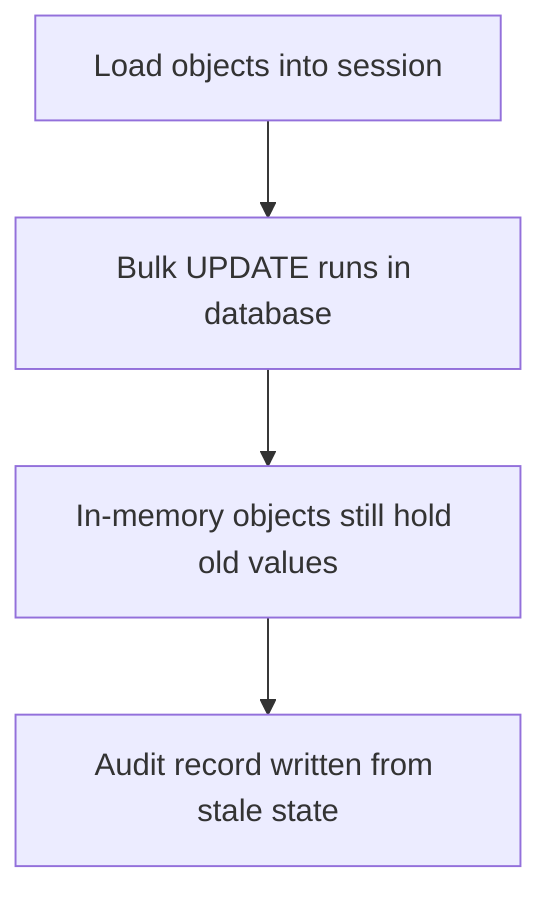
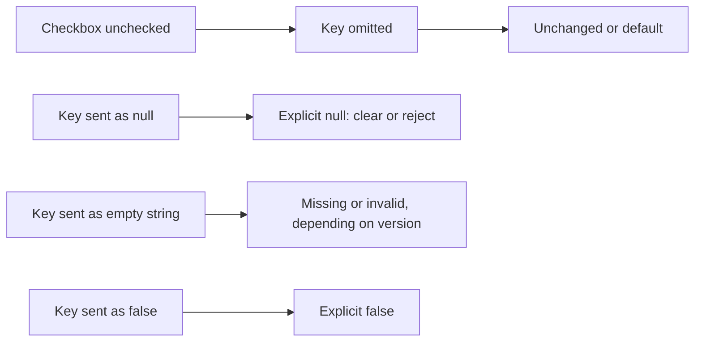

# Learning workshop — 2026-11-02

**Status:** DRAFT for Learning Coach review. Not a permanent resource. No files were created or changed.
**Run:** monthly_core, window 2026-09-28 to 2026-11-02. Installed versions are unknown.

## Why these concepts matter this week

The release window is dominated by one risk pattern: wrong results that do not raise an error. The report describes items 1, 2 and 5 as silent wrong query results or values. Items 3, 7 and 9 describe values reaching code or storage without the check that should have caught them. A test suite that only looks for exceptions will miss these changes, so the workshop focuses on the concepts that explain why an upgrade can change results silently and how to check for it.

Because the relevant topic and review-card files are empty placeholders, no finalized entry exists to compare against. Every candidate is therefore classified NEW CONCEPT. The Pydantic 1.x and data.table watch items are included where they teach a reusable concept. plumber has no High or Urgent change in the window, so it is NO UPDATE NEEDED and is not taught.

### Learning objectives

By the end of the session, the learner should be able to:

1. Explain why silent wrong results are more dangerous than exceptions in data pipelines, and name checks that detect them.
2. Distinguish a missing value, an explicit null, an empty string, a default and an explicit false in request inputs, and state how their own endpoints handle each.
3. Explain how ORM session state can diverge from database state after relationship loading or bulk statements.
4. Triage a dependency advisory by checking version range, code path and validation mode.
5. Define an upgrade gate: version pin, contract tests and rollback criteria.

### Session outline (110 minutes)

| Time | Block | Content |
|---|---|---|
| 0:00–0:10 | Orientation and inventory | Collect installed versions of SQLAlchemy, FastAPI, Pydantic, data.table and plumber from lockfiles. Without this, exposure cannot be determined. |
| 0:10–0:35 | Databases (C1–C3, C7 SQL part) | Items 1–4. Run the hands-on exercises. |
| 0:35–0:55 | API input semantics (C4, C5) | Items 5–8. Compare results across versions where possible. |
| 0:55–1:20 | Pydantic validation and security (C6–C8) | Items 9–11. Check JSON mode and extra-key handling. |
| 1:20–1:35 | Data processing and watch items (C9) | Item 12, with item 13 confirmed as no change. |
| 1:35–1:50 | Upgrade gate and cards (C10) | Pinning, contract tests, and review-card drafting. |

## Learning map

```text
Data enters at a boundary (HTTP request, form, JSON, DB query, data frame)
↓
Presence semantics: missing ≠ null ≠ empty ≠ default ≠ false           [C4]
↓
Defaults and validation timing                                          [C5]
↓
Schema openness and value domains                                       [C6, C7]
↓
Advisories: affected range, code path, cost on untrusted input          [C8]
↓
Upgrade gate: pin + contract tests + rollback criteria                  [C10]

Database track:
Bound parameters → relationship loading → session state                 [C1 → C2 → C3]

Data-processing track:
Join cardinality → NA semantics                                         [C9]
```

## Concepts

**Grounding tags used below:**
- **[Report]**: stated in the release report as supplied.
- **[General]**: general teaching context, not stated in the report.
- **[Inference]**: my reasoning from the report, to be verified in the exercises.

The cited URLs were not opened in this draft. Report-based claims are taken as supplied.

### Release item map

| Item | Concept | Hands-on exercise | Check for understanding |
|---|---|---|---|
| 1. SQLAlchemy 2.1.6, IN parameter collision | C1 | In a scratch venv, build a query combining `column.in_(ids)` with another bound parameter. Print the compiled SQL and parameters, then compare with expected rows. A local database may not reproduce the bug, so focus on inspecting the placeholders. | Why can a query return wrong rows without an error? Name one place in your code where `in_()` is combined with other bound parameters. |
| 2. SQLAlchemy 2.1.2, selectinload many-to-many | C2 | Model parent, association and child tables, with a relationship join condition that includes an extra filter. Load with `selectinload`, log the SQL, and compare with an explicit query using the same filter. | Where does the relationship's join condition belong compared with a query's WHERE clause? Which path did the report say ignored the extra criteria? |
| 3. SQLAlchemy 2.1.5 / 2.0.55, stale ORM values | C3 | Load three ORM objects, run a bulk `update()` matching them, then compare in-memory values before and after. Repeat with different `synchronize_session` settings, then with `session.refresh()` or expiry. | After a bulk UPDATE, which copy of the data is authoritative, and what must you do before reading it? |
| 4. SQLAlchemy 2.1.4, MSSQL division fix (watch) | C7 | Reflection only, unless SQL Server is available. If available, compare `SELECT 7/2` on the server with Python's result. | Why does integer division of two integer columns return an integer in SQL? Do any of your queries depend on this? |
| 5. FastAPI 0.147.0–0.161.x, bool form fields | C4 | Build an endpoint with `flag: bool = True` as a form field. Submit a form that omits the field, a form with an empty value, and a form with `false`. Repeat in a second venv on a pinned version if time allows. | An unchecked HTML checkbox sends nothing. How should the server represent "not submitted" differently from "submitted false"? |
| 6. FastAPI 0.151.0, explicit null vs omitted | C4 | Body model with `name: str` and `nickname: str \| None = None`. Send `{}`, `{"name": null}` and `{"name": "x", "nickname": null}`. Record the responses per version. | What is the difference between omitted and null in a PATCH endpoint, and what does your data layer do with each? |
| 7. FastAPI 0.148.0, defaults not validated | C5 | Pydantic model `class M(BaseModel): n: int = "10"`. Print `M().n` and its type, then repeat with validation of defaults enabled. Add a FastAPI query parameter whose default violates its own `ge` constraint. | Why does a default bypass validation by default, and what goes wrong if the default is invalid? |
| 8. FastAPI 0.145.0 and 0.155.0, startup errors; 0.160.0 and OpenTelemetry opt-in | C10 | In a scratch app, set an unsupported configuration option and observe startup. List where that option is set in your deployment pipeline. | Why is failing at startup better than failing on the first production request? |
| 9. Pydantic 2.14.2, extra keys and JSON mode | C6, C8 | Model with `extra='allow'`. Validate JSON containing an extra key whose value has the wrong type, then validate the same data in Python mode. Record whether each is accepted, on your installed version. | Why does an open schema widen the attack surface? What changes under `extra='forbid'` for keys matching a field name? |
| 10. Pydantic 2.14.1, Decimal and timedelta limits | C7 | Field with `max_digits=5, decimal_places=2`. Test `"123.45"`, `"1234.5"` and `"12.345"`. For timedelta, test a large out-of-range integer. Compare two versions if available. | What is the difference between `max_digits` and `decimal_places`? Which limit did the report say is now enforced? |
| 11. Pydantic 1.10.27, ISO 8601 durations and unique_items | C7, C8 | If any V1 code exists, test `PT1,5S` and `PT1.5S`. Measure validation time for a long list of attacker-sized input. Find every endpoint that validates lists from untrusted sources. | What makes validation cost depend on attacker-controlled input size? Which of your lists have a maximum length? |
| 12. data.table 1.18.99 pre-release (watch) | C9, C10 | In R, perform a keyed join with duplicate keys on the right side and compare row counts with `merge()`. Do not install the unreleased version. Search your code for uses of `froll*` with `hasNA`. | How do 1:1, 1:many and many:many joins change row counts? What should a keyed join do on duplicate keys? |
| 13. plumber, no change | None taught | No exercise. Confirm the installed version and move on. | Not applicable. NO UPDATE NEEDED. |

### C1. Bound parameters and expanding IN lists

- **Classification:** NEW CONCEPT. The databases topic file is empty.
- **Grounding:** Item 1 [Report]. Parameter binding and expansion [General]. The exact collision mechanism is not in the report [Inference only].
- **Prerequisites:** SQL query execution; bind parameters, which keep values separate from SQL text; the fact that a variable-length `IN (...)` list needs one placeholder per value.
- **Intuition:** A query is a template with named slots. When a list of values fills one slot, the library must create one slot per value. If the generated slot names clash with other slots, values can land in the wrong place, and the database still runs the query.
- **Precise explanation:** SQL text and values are sent separately. For an expanding IN parameter, the library typically expands one named parameter into N placeholders at execution time [General]. The report states that expanded parameter names can collide, which can produce silent wrong query results [Report, item 1]. Because the query is valid, no exception is raised.
- **Example:** A pipeline builds `customer_id IN :ids AND status = :status` inside a loop with user-selected filters. If a name collision binds an ID where the status should be, the query returns plausible rows with normal-looking counts. [Inference: illustrative.]
- **Why it matters:** Parameter binding prevents SQL injection, but it does not prevent logic errors. Tests that only check for exceptions will not see this failure.
- **Common misconception:** "If the query runs without error, the bound values are correct." Errors and wrong results are different failure modes.
- **Adjacent concepts:** SQL injection (C1 addresses correctness, not security); query compilation; transactions; result verification with row-count and checksum checks.
- **Topic-file destination:** `learning/databases.md`, under a query-execution or parameters category. The file is empty, so no section exists yet. This is the closest fit for the index entry "query execution."
- **Review-card destination:** `review-cards/databases.md`, query-execution category. The file is empty; the coach should choose the section.

### C2. Relationship loading strategies and join conditions

- **Classification:** NEW CONCEPT.
- **Grounding:** Item 2 [Report]. Loader strategies and association tables [General]. Item 2 references #5987 and gives no URL.
- **Prerequisites:** Relational joins and foreign keys; many-to-many relationships through an association table; the N+1 query pattern.
- **Intuition:** An ORM relationship is a rule defining which child rows belong to a parent. A loading strategy is a choice of how to fetch those rows. Every strategy must apply the same rule.
- **Precise explanation:** `selectinload` runs a separate query for related rows, filtered by the parent keys [General]. For many-to-many relationships, that query goes through the association table. Extra criteria defined in the relationship's join condition must appear in every generated query. The report states that the many-to-many `selectinload` path ignored these extra criteria, which returns silent wrong results [Report, item 2].
- **Example:** Customers are linked to orders through an association table, and the relationship includes `is_active = true`. Loading customers with `selectinload` for a dashboard shows inactive orders. [Inference: illustrative.]
- **Why it matters:** Eager loading is a standard performance fix. If it changes which rows are returned, a performance change becomes a correctness bug.
- **Common misconception:** "Eager loading changes when rows are fetched, not which rows." Loading strategy should not change results.
- **Adjacent concepts:** N+1 queries; `joinedload` vs `selectinload`; the difference between WHERE and ON conditions in outer joins (C1 and C3 are the same database track).
- **Topic-file destination:** `learning/databases.md`, under ORM or relationship loading, a proposed sub-category. Nothing in the empty file suggests an existing section.
- **Review-card destination:** `review-cards/databases.md`. Coach to choose the section.

### C3. Session state versus database state

- **Classification:** NEW CONCEPT.
- **Grounding:** Item 3 [Report]. Identity map and `synchronize_session` behaviour [General].
- **Prerequisites:** Transactions and commit; the ORM unit of work and identity map; the difference between row-level and bulk operations.
- **Intuition:** The ORM keeps an in-memory copy of rows it has loaded. A bulk UPDATE changes the database directly, and the in-memory copies may not know.



- **Precise explanation:** Objects loaded into a session are tracked by identity. A bulk statement that matches several tracked objects may leave their attributes stale unless the session is synchronized, expired or refreshed [General]. The report states that bulk ORM `update()` leaves stale values when its WHERE clause matches several session objects, a regression from #11917 introduced in 2.0.36 [Report, item 3].
- **Example:** A job loads 500 account objects, closes one region's accounts with a bulk UPDATE, then writes an audit trail from the in-memory objects. The audit trail records the old status. [Inference: illustrative.]
- **Why it matters:** Stale state looks like valid data. It can pass checks that compare values within the same session.
- **Common misconception:** "After `session.execute(update(...))`, every loaded object is current." This is not guaranteed.
- **Adjacent concepts:** Transaction isolation (other transactions' changes); cache invalidation; C2 (loading strategy changes what is in the session).
- **Topic-file destination:** `learning/databases.md`, under transactions or ORM session behaviour. Proposed sub-category, since the file is empty.
- **Review-card destination:** `review-cards/databases.md`. Coach to choose the section.

### C4. Presence semantics in request inputs

- **Classification:** NEW CONCEPT.
- **Grounding:** Items 5, 6 and the related 0.149.0, 0.150.0 and 0.153.0 notes [Report]. HTML form and JSON semantics [General].
- **Prerequisites:** HTTP request bodies (form-encoded vs JSON); HTML form submission rules; the difference between a missing key and a key whose value is null.
- **Intuition:** "Not sent", "sent as null", "sent as empty" and "sent as false" are four different facts. Many systems collapse them into one.



- **Precise explanation:** HTML forms omit unchecked checkboxes [General]. JSON distinguishes an absent key from an explicit null [General]. The report states that FastAPI 0.147.0 read omitted bool form fields as False, reverted in 0.162.0. It also states that 0.151.0 distinguishes explicit null from omitted and rejects null for non-nullable body fields with a 422, and that 0.149.0, 0.150.0 and 0.153.0 treat empty form strings and unselected file inputs as missing [Report, items 5, 6].
- **Example:** A `PATCH /subscriptions` endpoint has a `newsletter` field. An omitted field should leave the stored value unchanged. An explicit null may need its own meaning. An unchecked box should not unsubscribe a user because the field was omitted. [Inference: illustrative of the failure pattern in item 5.]
- **Why it matters:** Silent change, such as unsubscribing users, is harder to detect than a 422 error.
- **Common misconception:** "A missing boolean is the same as false," or "null and missing are the same in JSON."
- **Adjacent concepts:** HTTP methods (PUT vs PATCH semantics); backwards compatibility of APIs; C5 (defaults).
- **Topic-file destination:** `learning/apis-and-networking.md`, under requests and responses. The file is empty; the section is proposed.
- **Review-card destination:** `review-cards/apis-and-networking.md`. Coach to choose the section.

### C5. Validation timing: defaults are trusted unless validated

- **Classification:** NEW CONCEPT.
- **Grounding:** Item 7 [Report]. Pydantic's default of not validating defaults [General]. The report states that FastAPI defaults are not validated unless `validate_default=True` is set.
- **Prerequisites:** Schema validation at a boundary; what a default value is; the boundary between incoming data and application code.
- **Intuition:** Validation checks values that arrive. A default is written by the developer and inserted without the same check. An invalid default can therefore reach the application unchanged.
- **Precise explanation:** Validators typically run on supplied values. Default values bypass them unless configured otherwise [General; report item 7 for FastAPI]. The application can then receive a type or range that the schema would reject.
- **Example:** An endpoint declares a `limit` query parameter with a default of 0 and a constraint requiring at least 1. Without validation of defaults, the code receives 0 and runs `LIMIT 0`, which returns no rows and raises no error. [Inference: illustrative; verify in the exercise.]
- **Why it matters:** Schema constraints give false assurance when defaults are excluded.
- **Common misconception:** "If the schema says `ge=1`, every value the code sees satisfies `ge=1`."
- **Adjacent concepts:** C4 (missing vs default); C6 (schema openness); contract tests (C10).
- **Topic-file destination:** `learning/validation-and-data-quality.md`, under schemas and validation. The file is empty; the section is proposed.
- **Review-card destination:** `review-cards/validation-and-data-quality.md`. Coach to choose the section.

### C6. Open vs closed schemas and unknown keys

- **Classification:** NEW CONCEPT.
- **Grounding:** Item 9 [Report], including GHSA-3r8g-cqwr-jr29. Open and closed schema design [General].
- **Prerequisites:** Schema definitions; JSON objects as key-value maps; mass assignment (where extra input fields are written into objects or storage).
- **Intuition:** A closed schema says "only these keys are allowed." An open schema says "anything else is allowed too." Open schemas can pass unvalidated keys through to storage or business logic.
- **Precise explanation:** Pydantic's `extra` setting controls unknown keys: ignore, forbid or allow [General]. The report states that in JSON-mode validation with `extra='allow'`, the types of extra keys were not validated before 2.14.2 (GHSA-qpmf-fgh3-ff25). Python mode was not affected. GHSA-3r8g-cqwr-jr29 states that, for TypedDict and dataclasses with `extra='allow'`, extra data whose key matches a field name was ignored, and that with `extra='forbid'` such keys now raise a ValidationError [Report, item 9].
- **Example:** An event-ingestion API uses `extra='allow'` and stores the whole payload in a JSON column. Downstream jobs read certain extra keys as typed fields. A producer sends an extra key with an unexpected type, and the downstream job fails or computes wrong results. [Inference: illustrative.]
- **Why it matters:** Open schemas are a common source of unvalidated data that is later treated as validated.
- **Common misconception:** "`extra='allow'` only keeps extra data and does not affect validation of the known fields."
- **Adjacent concepts:** Allowlisting; mass assignment; data contracts; JSON vs Python validation mode; C8 (security triage).
- **Topic-file destination:** `learning/validation-and-data-quality.md`, under schemas and data contracts. Proposed section, since the file is empty.
- **Review-card destination:** `review-cards/validation-and-data-quality.md`. Coach to choose the section.

### C7. Numeric and value domains: precision, range and parsing

- **Classification:** NEW CONCEPT.
- **Grounding:** Items 10 and 11 (ISO 8601 durations) [Report]. Item 4 (MSSQL division) [Report, watch item]. Numeric type semantics [General].
- **Prerequisites:** Integer, decimal and floating-point types; the difference between precision and scale; ISO 8601 duration format [General].
- **Intuition:** A numeric type does not define every valid value. You need explicit domain rules for range and digits. Parsers also differ in what text they accept.
- **Precise explanation:**
  - `max_digits` limits total significant digits, and `decimal_places` limits fractional digits [General]. The report states that 2.14.1 enforces the whole-digits limit [Report, item 10].
  - The report states that 2.14.1 rejects out-of-range integer inputs for timedelta [Report, item 10].
  - The report states that 1.10.27 accepts only "." as the decimal separator for ISO 8601 durations [Report, item 11].
  - Item 4 shows that SQL division behaviour depends on the database dialect [Report, watch item].
- **Example:** A field with `max_digits=5` and `decimal_places=2` should reject "1234.5". It has four whole digits, but the whole-digit limit is three. A check that counts only total digits would accept it. [Inference: verify in the exercise, since the behaviour is as reported.]
- **Why it matters:** Numbers that pass type checks can still be out of domain. Dialect differences can change results between a Python check and a database query.
- **Common misconception:** "`Decimal(max_digits=N)` allows N digits after the decimal point." It limits total digits.
- **Adjacent concepts:** Floating-point error; column types such as NUMERIC(p, s); C6 (domain constraints); C8 (cost of parsing untrusted input).
- **Topic-file destination:** `learning/validation-and-data-quality.md`, under value constraints. The SQL division part (item 4) would also belong in `learning/databases.md`, under SQL semantics. Both are proposed.
- **Review-card destination:** `review-cards/validation-and-data-quality.md` for value constraints; `review-cards/databases.md` for the SQL dialect part.

### C8. Security advisories: affected ranges, code paths and cost on untrusted input

- **Classification:** NEW CONCEPT.
- **Grounding:** Items 9 and 11 [Report]. CVSS, GHSA and version-range triage [General].
- **Prerequisites:** Semantic versioning and version ranges; the anatomy of an advisory (affected range, severity, fixed version); the idea of algorithmic complexity.
- **Intuition:** An advisory raises three questions. Are we in the affected range? Does our code path reach the vulnerable behaviour? What does the fix change? Triage needs all three answers.
- **Precise explanation:**
  - GHSA-qpmf-fgh3-ff25 is rated Moderate, CVSS v4 6.3, with no CVE. The affected range is >=2.13.0 and <2.14.2. Only JSON-mode validation was affected [Report, item 9].
  - GHSA-49g6-96jj-f7r9 concerns `unique_items` in Pydantic 1.x. The report states that the fix concerns linear time. The prior complexity is not stated [Report, item 11].
  - Algorithmic complexity means that the cost of processing grows faster than the input size. An attacker who controls the input can then use disproportionate CPU [General].
- **Example:** An ingestion endpoint validates arrays from external clients. Without a maximum length, a very large array can make validation CPU-bound. Mitigations include list length limits and a request-size limit at the gateway. [Inference: illustrative.]
- **Why it matters:** Severity alone does not show exposure. A Moderate advisory on a path your service uses can matter more than a High advisory on a path it does not.
- **Common misconception:** "No CVE means no real risk," or "Python mode is not affected, so we are safe." The second statement is true only if the code uses Python mode exclusively.
- **Adjacent concepts:** CVSS and severity vs exposure; dependency scanning; rate and size limits; C6 (open schemas).
- **Topic-file destination:** `learning/security.md`, under dependency advisories or vulnerability triage. The file is empty; the section is proposed. Validation cross-reference: `learning/validation-and-data-quality.md`.
- **Review-card destination:** `review-cards/security.md`. Coach to choose the section.

### C9. Join cardinality and duplicate keys

- **Classification:** NEW CONCEPT.
- **Grounding:** Item 12 [Report]: unreleased 1.18.99 makes keyed joins error on duplicate key columns and removes `hasNA` from `froll*`. Join cardinality [General].
- **Prerequisites:** Relational keys; join types; row multiplication in many-to-many joins; the idea of a keyed table (R data.table) [General].
- **Intuition:** A join's result size depends on how many matching rows exist on each side. If a key you believe is unique is not unique, the join multiplies rows silently. A stricter library fails earlier.
- **Precise explanation:** A many-to-one join from a fact table to a dimension keeps the fact row count only when the dimension key is unique. A keyed join with duplicate right-side keys multiplies rows [General]. The report states that 1.18.99 will raise an error in this case, which is preferable to silent multiplication, although that is a judgement rather than a report claim [Inference]. Whether a rolling function skips or propagates missing values is part of its function contract. The report states that `hasNA` is removed from `froll*` in 1.18.99 but does not state the replacement [Report, item 12].
- **Example:** Orders are joined to a currency-rate table keyed by date and currency. If the rate table contains two revised rows for the same date and currency, each order is duplicated, and revenue is inflated by roughly that factor. [Inference: illustrative.]
- **Why it matters:** Row inflation in aggregated reports is hard to notice. A single extra row per key can move totals materially.
- **Common misconception:** "A join always preserves the row count of the left table." This holds only for a many-to-one join with a unique right-side key.
- **Adjacent concepts:** Deduplication; data-quality assertions (C5, C6); missing-value semantics; pre-release behaviour changes (C10).
- **Topic-file destination:** `learning/data-processing.md`, under transformations or joins. The file is empty; the section is proposed. Validation cross-reference: `learning/validation-and-data-quality.md`.
- **Review-card destination:** `review-cards/data-processing.md`. Coach to choose the section.

### C10. Dependency pinning, version ranges and upgrade gates

- **Classification:** NEW CONCEPT. The closest existing category is deployment and infrastructure, but its topic file was not supplied, so its existence and contents are unconfirmed.
- **Grounding:** Recommended next actions [Report]. Items 5, 8 and 12 [Report]. Pinning, lockfiles and contract testing [General].
- **Prerequisites:** Semantic versioning; lockfiles and transitive dependencies; CI test runs; contract tests (tests that check behaviour an interface promises).
- **Intuition:** A version range lets the next install choose a version. A lockfile records the choice. An upgrade gate is the test evidence that justifies changing the choice.
- **Precise explanation:** The report recommends checking lockfiles against fixed versions, pinning `fastapi>=0.162.0` after regression tests, and upgrading to Pydantic 2.14.2 after JSON contract tests [Report]. It also states that 0.162.0 may return 422 for required bool fields [Report, item 5]. A pin to >=0.162.0 therefore needs the bool-field test before adoption. Other upgrade risks named in the report include startup errors (item 8) and the end of Pydantic V1 support (item 11). The unreleased data.table 1.18.99 should be watched, not adopted [Report, item 12].
- **Example:** A requirements file pins a specific FastAPI version. CI runs a contract suite with bool-form, null and default cases. The pin changes only when that suite passes. [Inference: illustrative.]
- **Why it matters:** The report shows that a version change within a release line can change results. Upgrades need evidence, not only version numbers.
- **Common misconception:** "Patch and minor upgrades are safe because semantic versioning promises compatibility." The report shows FastAPI behaviour changing and being reverted across 0.147–0.162.
- **Adjacent concepts:** CI/CD; regression testing; fail-fast configuration (item 8); observability during upgrades (OpenTelemetry opt-in from 0.143.0, item 8).
- **Topic-file destination:** `learning/deployment-and-infrastructure.md` (not supplied; existence unconfirmed) for pinning and rollout. `learning/validation-and-data-quality.md` for contract tests.
- **Review-card destination:** The corresponding deployment review-card file was not supplied, so no confident mapping exists. Coach to confirm. The contract-test part goes to `review-cards/validation-and-data-quality.md`.

## Proposed permanent-resource changes

Under this run's constraint, no permanent changes are proposed. The index, topic files and review-card files are not to be edited in this draft. The routing below is for the Learning Coach to consider later.

- **Index (`learning/README.md`):** No change needed for the routing in this draft. Every destination above has an existing index entry, except that `deployment-and-infrastructure.md` was not supplied and its existence should be confirmed.
- **Topic files, all empty placeholders:**
  - `learning/databases.md`: C1, C2, C3 and the SQL division part of C7.
  - `learning/apis-and-networking.md`: C4.
  - `learning/validation-and-data-quality.md`: C5, C6, C7, and contract tests in C10.
  - `learning/security.md`: C8.
  - `learning/data-processing.md`: C9.
  - `learning/deployment-and-infrastructure.md`: C10 pinning (not supplied).
- **No new topic file** is proposed. Each subject fits an existing category.

## Proposed review cards

All cards are proposals. First learned is 2026-11-02 for each card.

**C1. Bound parameters and expanding IN lists**
- **Recall:** A bound parameter list can expand into placeholders whose names may collide, and a collision can return wrong rows without an error.
- **Mental hook:** Right SQL, wrong slot.
- **Why I care:** Parameter binding prevents injection but not logic errors.
- **Test yourself:** How would a wrong-row bug from `in_()` show up in row counts?
- **First learned:** 2026-11-02
- **Destination:** `review-cards/databases.md`, query-execution category (coach to choose).

**C2. Relationship loading and join conditions**
- **Recall:** A loading strategy must apply the relationship's full join condition, or it changes results.
- **Mental hook:** Same rule, different route.
- **Why I care:** Eager-loading fixes can change data.
- **Test yourself:** Where should a relationship filter live, and what happens if a loader drops it?
- **First learned:** 2026-11-02
- **Destination:** `review-cards/databases.md` (coach to choose).

**C3. Session state versus database state**
- **Recall:** A bulk UPDATE changes the database, not necessarily objects already loaded in a session.
- **Mental hook:** The database moved; the copy did not.
- **Why I care:** Audit and downstream writes can record stale values.
- **Test yourself:** What must happen before you read objects after a bulk statement?
- **First learned:** 2026-11-02
- **Destination:** `review-cards/databases.md` (coach to choose).

**C4. Presence semantics in request inputs**
- **Recall:** Missing, null, empty, default and false are different facts.
- **Mental hook:** Four states, one field.
- **Why I care:** Treating omission as false can silently change user data.
- **Test yourself:** What should an omitted field do in a PATCH request?
- **First learned:** 2026-11-02
- **Destination:** `review-cards/apis-and-networking.md` (coach to choose).

**C5. Validation timing and defaults**
- **Recall:** Defaults can bypass validation unless validation is explicitly applied to them.
- **Mental hook:** The schema checks what arrives, not what it assumes.
- **Why I care:** An invalid default can produce valid-looking but wrong queries.
- **Test yourself:** What does `limit: int = 0` with `ge=1` do when the parameter is omitted?
- **First learned:** 2026-11-02
- **Destination:** `review-cards/validation-and-data-quality.md` (coach to choose).

**C6. Open vs closed schemas**
- **Recall:** Open schemas pass unknown keys, which may reach storage or logic unvalidated.
- **Mental hook:** Allowlist, do not hope.
- **Why I care:** Unvalidated extra keys can be read later as typed fields.
- **Test yourself:** What is the difference between `extra='allow'` and `extra='forbid'` for a payload with an unexpected key?
- **First learned:** 2026-11-02
- **Destination:** `review-cards/validation-and-data-quality.md` (coach to choose).

**C7. Numeric and value domains**
- **Recall:** Type checks are not domain checks. Digits, range and parsing rules must be stated explicitly.
- **Mental hook:** Whole digits and fractional digits are separate budgets.
- **Why I care:** Numbers that pass a type check can still be out of domain.
- **Test yourself:** Under `max_digits=5, decimal_places=2`, why is "1234.5" invalid?
- **First learned:** 2026-11-02
- **Destination:** `review-cards/validation-and-data-quality.md`; SQL dialect part in `review-cards/databases.md`.

**C8. Advisory triage**
- **Recall:** An advisory is actionable only when the version range, code path and mode are all checked.
- **Mental hook:** Range, route, result.
- **Why I care:** Severity alone does not show exposure.
- **Test yourself:** Why does "Python mode not affected" not settle the question for a JSON API?
- **First learned:** 2026-11-02
- **Destination:** `review-cards/security.md` (coach to choose).

**C9. Join cardinality and duplicate keys**
- **Recall:** A join preserves left-side rows only when the right-side key is unique.
- **Mental hook:** Duplicate keys multiply rows.
- **Why I care:** Revenue and counts can inflate silently.
- **Test yourself:** How many rows result from joining two rows with the same key on each side?
- **First learned:** 2026-11-02
- **Destination:** `review-cards/data-processing.md` (coach to choose).

**C10. Upgrade gates**
- **Recall:** Pins and lockfiles record a decision. Contract tests provide the evidence for changing it.
- **Mental hook:** No upgrade without a test that could fail.
- **Why I care:** Within-line versions have changed behaviour in this window.
- **Test yourself:** What evidence should a team require before moving to FastAPI 0.162.0?
- **First learned:** 2026-11-02
- **Destination:** Deployment review-card file not supplied; coach to confirm. Contract-test part in `review-cards/validation-and-data-quality.md`.

## Questions worth discussing

1. Why are silent wrong results more dangerous than exceptions for a data pipeline, and which checks would have caught them in your own code?
2. Which of your endpoints treat missing, null and false as the same thing, and how would you find out?
3. The report recommends pinning `fastapi>=0.162.0`, but also says 0.162.0 may return 422 for required bool fields. How would you resolve this before upgrading?
4. For your Pydantic models, which ones use JSON mode, and which use `extra='allow'`? What would you need to know to decide whether GHSA-qpmf-fgh3-ff25 applies?
5. Should join cardinality assertions be a default in data-processing code? What does that cost in performance and maintenance?
6. Which of your default values could violate their own constraints if validation were skipped?

## Safety and permanence

- This output is a **DRAFT** for discussion with a Learning Coach.
- No files were created, modified, overwritten or appended. The index, topic files and review-card files are unchanged.
- No finalized entries exist in the relevant topic or review-card files. Every candidate is NEW CONCEPT for that reason.
- Proposed cards and destinations are recommendations only, and are not completed changes.

### Open evidence gaps

- **Installed versions unknown.** Exposure to any item cannot be determined until lockfiles are checked.
- **SQLAlchemy #13695 and #13626:** affected ranges are not stated. The #13695 fix was backported to 2.0.56, which is not yet released. Whether 2.0.55 includes the #13695 fix is not stated.
- **SQLAlchemy #13626:** the regression from #5987 is not given with an affected version range.
- **SQLAlchemy #11917 and item 3:** the affected range is described only as introduced in 2.0.36. Other affected versions are not stated.
- **SQLAlchemy #13631 (item 4):** no URL or detail is given in the report.
- **FastAPI range:** "0.147.0 to 0.161.x" is a wildcard range. Whether every version in it has the bool-default behaviour is not confirmed.
- **FastAPI 0.162.0 tension:** the report says 0.162.0 may return 422 for required bool fields, yet recommends pinning `>=0.162.0`. This needs a regression test. It is not resolved here.
- **FastAPI 0.145.0 and 0.155.0 (item 8):** the report's notation "(**extra)" is unclear. The exact startup errors and affected parameters are not stated. The 0.160.0 and OpenTelemetry notes have no detail.
- **Pydantic GHSA-3r8g-cqwr-jr29:** the affected range is not stated.
- **Pydantic 2.14.1 (item 10):** behaviour in 2.14.0 is not stated, so whether 2.14.0 users were affected is unknown.
- **Pydantic 1.10.27 (item 11):** the report says the pydantic.v1 namespace ends. It does not state whether it is removed from v2 installs, or on what date.
- **GHSA-49g6-96jj-f7r9:** the prior complexity of `unique_items` is not stated. Only the "linear time" fix claim is given.
- **data.table 1.18.99 (item 12):** the unreleased pre-release is not confirmed to be released. The replacement for `hasNA` is not stated, and the keyed-join error is not described in detail.
- **plumber (item 13):** no URL or ticket is given.
- **Missing URLs:** items 2 (#5987), 3 (#11917), 4 (#13631) and 13 have no URL in the report. Only the URLs listed below were supplied.
- **Sources not opened:** the cited URLs were not opened for verification in this draft. Report-based statements are as supplied.
- **Empty baseline:** the relevant topic and review-card files are empty placeholders, so no baseline comparison is possible.
- **Not supplied:** `learning/deployment-and-infrastructure.md` and its review card were not supplied, so C10's destination is unconfirmed.
- **General context, not from the report:** bound-parameter mechanics, the ORM identity map, `selectinload` mechanics, HTML form submission rules, Pydantic default validation, `max_digits` and `decimal_places` definitions, ISO 8601 format, CVSS and GHSA triage, and join cardinality rules.

### Sources

Only the URLs supplied in the release report are listed here:

- https://docs.sqlalchemy.org/en/21/changelog/changelog_21.html
- https://www.sqlalchemy.org/trac/ticket/13695
- https://www.sqlalchemy.org/trac/ticket/13626
- https://www.sqlalchemy.org/trac/ticket/13675
- https://github.com/fastapi/fastapi/releases
- https://github.com/pydantic/pydantic/releases/tag/v2.14.2
- https://github.com/pydantic/pydantic/security/advisories/GHSA-qpmf-fgh3-ff25
- https://github.com/pydantic/pydantic/security/advisories/GHSA-3r8g-cqwr-jr29
- https://github.com/pydantic/pydantic/releases/tag/v2.14.1
- https://github.com/pydantic/pydantic/releases/tag/v1.10.27
- https://raw.githubusercontent.com/Rdatatable/data.table/master/NEWS.md
